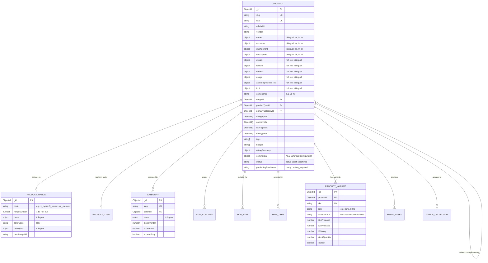
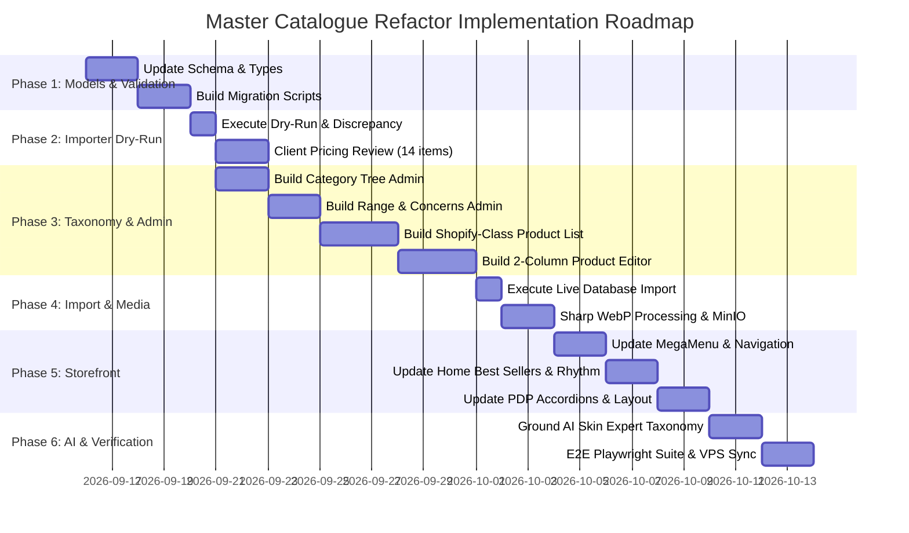

# IOMA PARIS DUBAI — MASTER CATALOGUE & PRODUCT MANAGEMENT REFACTOR

## Comprehensive Technical & Product Architecture Implementation Plan

---

### Executive Summary

This document establishes the authoritative technical blueprint and information architecture for the **IOMA Paris Dubai Master Catalogue & Product Management Refactor**.

Following exhaustive automated audits of the **Official IOMA Shopify Product Export (`ioma-paris-eshop-FR-product-export_2026-09-14.xlsx`)**, the **live France digital flagship (`https://ioma-paris.com/`)**, and the **existing Dubai production platform (`c:\Users\Ala\Desktop\ioma`)**, this plan delivers:

1. **Definitive Taxonomy Resolution**: Eliminating conceptual overlap by formally defining **Product**, **Product Type**, **Storefront Category**, **IOMA Branded Gamme (Range)**, **Skin Concern**, **Skin Type**, **Hair Type**, **Tags**, and **Merchandising Collections**.
2. **Deterministic Data Ingestion & Grouping Architecture**: Resolving the 251-row Shopify Matrixify export into **63 unique products** (55 IOMA Paris Skincare/Body, 8 IOMA Haircare), 235 high-resolution photography assets, 20 distinct Product Types, 10 Gammes, and 32 Skin Concerns.
3. **Strict Commercial Isolation**: Permanently separating official French formulation/clinical content from Dubai commercial configuration (authoritative AED pricing, UAE stock, B2B wholesale MOQ, tax/compliance).
4. **Professional Shopify-Class Admin Experience**: Rebuilding the Product Management and Taxonomy Back Office from generic CRUD into an operationally dense, IBM Carbon-inspired workspace featuring a 2-column editor (Content Canvas + Organization Sidebar), bulk actions, saved views, and visual media sequencing.
5. **Storefront Merchandising Alignment**: Synchronizing the Dubai Public Navigation, Homepage content rhythm, Collection Facets, and PDP Anatomy with the live Paris flagship while preserving UAE-exclusive capabilities (AI Skin Expert 2.0, AED currency, trilingual EN/FR/AR with true RTL, Clinic Booking, and B2B Portal).

---

### 1. Primary Source Audits & Exact Statistics

#### 1.1 Source A: Official Shopify Product Export (`2026-09-14`)

- **Worksheets**: 1 (`Products`)
- **Total Columns**: 93 columns (incorporating 52 custom/app metafields)
- **Total Rows**: 251 rows
- **Grouping Behavior**:
  - **Top Rows (`Top Row == True`)**: Exactly **63 rows** representing 63 unique sellable products. Every top row contains the master identity, title, type, vendor, tags, body HTML, and all custom formulation metafields.
  - **Secondary Rows (`Top Row == None`)**: **188 rows** representing additional image attachments (`Image Src` with `Image Type: IMAGE`) and product variants.
- **Unique Products Identified**: **63 products**
  - Vendor `IOMA Paris`: 55 products
  - Vendor `IOMA Haircare`: 8 products
- **Media Assets**: **235 total product photography references** across 63 products (100% of products have at least 1 image; average 3.73 images per product).
- **Catalog Statuses**: 63 `Active` (0 Draft, 0 Archived in export).

##### Product Types Discovered (20 Official Types)

| Shopify Product Type       | Count | Scope              | Primary Recommended Form Factor               |
| :------------------------- | :---: | :----------------- | :-------------------------------------------- |
| **Routine**                |  12   | Bundles & Box Sets | Multi-product treatment routine               |
| **Crème de jour et nuit**  |   8   | Skincare (Face)    | 24h Moisturizing & Regenerating Cream         |
| **Sérum**                  |   8   | Skincare (Face)    | High-potency active serum                     |
| **Masque**                 |   4   | Skincare (Face)    | Treatment mask                                |
| **Nettoyant**              |   4   | Cleansing (Face)   | Cleansing foam, water, emulsion               |
| **Crème de jour**          |   3   | Skincare (Face)    | Day cream (including Bespoke Ma Crème Jour)   |
| **Gommage**                |   3   | Exfoliation (Face) | Facial scrub / peeling                        |
| **Soin contour des yeux**  |   3   | Eye Care (Face)    | Targeted eye contour cream                    |
| **Après-shampooing**       |   3   | Haircare           | Conditioning balm                             |
| **Shampooing**             |   2   | Haircare           | Hair & scalp cleanser                         |
| **Démaquillant**           |   2   | Cleansing (Face)   | Makeup remover                                |
| **Crème de nuit**          |   2   | Skincare (Face)    | Night cream (including Bespoke Ma Crème Nuit) |
| **Sérum cheveux**          |   1   | Haircare           | Hair & scalp essence serum                    |
| **Masque cheveux**         |   1   | Haircare           | Intensive hair mask                           |
| **Crème mains**            |   1   | Body Care          | Hand treatment                                |
| **Protection solaire**     |   1   | Sun Protection     | Urban SPF Shield                              |
| **Gommage corps**          |   1   | Body Care          | Body exfoliant                                |
| **Crème corps**            |   1   | Body Care          | Body firming & hydrating cream                |
| **Soin lèvres et contour** |   1   | Lip Care           | Volumizing lip balm                           |
| **Carte cadeau**           |   1   | Gifting            | Digital gift card                             |

##### Gammes / Branded Ranges (10 Official Gammes)

| Branded Gamme         | Count | Charter Code & Identity                                                             |
| :-------------------- | :---: | :---------------------------------------------------------------------------------- |
| **3 - Renew**         |  14   | Anti-aging, cellular regeneration, wrinkles (Range Color: Charcoal/Burgundy)        |
| **Haircare**          |   8   | IOMA Haircare scalp & fiber ecosystem (Range Color: Warm Slate)                     |
| **1 - Hydra**         |   7   | Essential hydration, moisture balance (Range Color: Sky Blue `#4A90E2`)             |
| **7 - Illumine**      |   7   | Radiance, dark spots, skin evenness (Range Color: Bright Gold)                      |
| **2 - Energize**      |   5   | First signs of aging, radiance, anti-fatigue (Range Color: Vibrant Coral `#FF6F61`) |
| **5 - Pureté**        |   5   | Acne, sebum control, imperfections, pores (Range Color: Mint Green)                 |
| **Soin sur mesure**   |   4   | Personalized bespoke skincare (Ma Crème Jour/Nuit, Mon Sérum, Mon Soin Yeux)        |
| **Cocoon**            |   3   | Body care, pampering, firmness (Range Color: Soft Cashmere)                         |
| **4 - Calm**          |   2   | Sensitive skin, redness, soothing (Range Color: Soft Rose)                          |
| **6 - Matte**         |   1   | Shine control, astringent, mattifying (Range Color: Sage Green)                     |
| _(No Gamme assigned)_ |   7   | Includes 5 multi-range routine bundles, 1 Gift card, 1 IEVA diagnostic patch kit    |

##### Skin Concerns (`custom.preoccupations`) (32 Values)

Top concerns: _Déshydratation (30), Teint terne (25), Anti-âge (22), Rides (19), Fermeté (18), Ménopause (17), Ridules (16), Fatigue (13), Pollution (12), Imperfections (11), Teint uniforme (10), Taches (10), Pores dilatés (9), Matité (7), Sensibilité (6), Rougeurs (5)._
_Data Quality Findings_: Discovered plural and casing anomalies in the raw export: `Fermetés` (1), `Teint ternes` (1). Normalization pipeline canonicalizes these to `Fermeté` and `Teint terne`.

##### Skin Types (`custom.nature_de_peau_`) (8 Official Values)

_Mixte (44), Normale (42), Déshydratée (37), Sèche (36), Mature (32), Grasse (27), Sensible (24), Très grasse (18)._

##### Hair Types (`custom.nature_de_cheveux`) (9 Official Values)

_Cheveux secs (7), Cheveux normaux (6), Cheveux mixtes (4), Cheveux déshydratés (3), Cheveux colorés (3), Cheveux décolorés (3), Cheveux matures (3), Cheveux gras (2), Cuir chevelu gras (1)._

##### Badges (`custom.badges`)

_Meilleure vente (11), Anti-taches (2), Anti-âge (2), Anti-imperfections (2), Hydratation (2), Éclat (1), Nouvelle routine (1), Cheveux (1), Corps (1)._

---

#### 1.2 Source B: Live IOMA Paris Flagship (`ioma-paris.com`) Audit

##### Header & Navigation Architecture

The flagship uses a multi-tier top navigation:

1. **Top Utility Bar**: Language selector (`FR`, `EN`, `IT`), Store locator, Currency indicator (`EUR €`).
2. **Main Header Bar**: Centralized IOMA Paris lockup, Search drawer, Account link, Slide-out Cart Drawer.
3. **Primary Navigation Bar**:
   - **UV & PROTECTION**: Direct link to `/collections/solaire-anti-pollution`.
   - **SOINS SUR MESURE**: High-profile dropdown featuring direct links to the personalized franchise:
     - _Ma Crème Jour_
     - _Ma Crème Nuit_
     - _Mon Sérum_
     - _Mon Soin Yeux_
     - _Mon Élixir Cheveux_
     - _Diagnostic MyIEVA / SkinDiag_
   - **VISAGE (The Core 3-Pillar Mega Menu)**:
     - **Column 1 — Vos Préoccupations (16 skin concerns)**: _Déshydratation, Ménopause, Anti-âge, Ridules, Rides, Fermeté, Rougeurs, Sensibilité, Teint terne, Taches, Teint uniforme, Imperfections, Matité, Pores dilatés, Pollution, Fatigue._
     - **Column 2 — Nos Catégories (9 product form factors)**: _Démaquillant, Nettoyant, Gommage, Masque, Crème Jour, Crème Nuit, Crème Jour et Nuit, Sérum, Contour des yeux._
     - **Column 3 — Nos Gammes (7 branded collections + Best Sellers)**: _Meilleures ventes, 1 Hydra, 2 Energize, 3 Renew, 4 Calm, 5 Pureté, 6 Matte, 7 Illumine._
     - **Column 4 — Featured Editorial / Product Card**: Dynamic promotional card highlighting a flagship innovation.
   - **CORPS**: Direct link to `/collections/soins-corps-gamme-cocoon`.
   - **CHEVEUX**: Direct link to `/collections/soins-cheveux-haircare`.
   - **KITS & ROUTINES**: Direct link to `/collections/kits-et-routines`.
   - **INSIDE IOMA**: Editorial storytelling dropdown:
     - _La Maison IOMA (Heritage, Science, Jean Michel Karam founder story)_
     - _La Technologie (MEMS sensors, 4D skin diagnostics, clinical proof)_
     - _Les Soins en Institut / Spa Partners_
     - _Journal de Beauté (Skincare articles & routines)_

##### Homepage Content Rhythm

1. **Hero Storytelling**: Full-width campaign banner featuring seasonal innovation or personalized skincare with dual CTAs (_Découvrir_, _Diagnostic_).
2. **Nos Meilleures Ventes (Best Sellers Carousel)**: 4-card horizontal carousel featuring high-ranking packshots, official range tags, star ratings (e.g. 4.85/5), EUR prices, and quick-add actions.
3. **Social Proof & Customer Reviews**: Judge.me aggregate rating module (_"4.8/5 basé sur plus de 1200 avis vérifiés"_).
4. **Nos Routines & Kits**: Editorial showcase presenting 3-step targeted routines (e.g., Hydratation, Anti-âge, Anti-taches).
5. **Notre Sélection**: Editorial product pairs highlighting targeted clinical duos (e.g., Day & Night duo, Sérum + Crème).
6. **Inside IOMA / Science Featurette**: High-tech microscopic imagery detailing active ingredient concentrations and patented sensor diagnostics.
7. **Trust & Service Benefits**: Free shipping threshold, 3 complimentary luxury samples, secure payment, clinical warranty.

##### Product Detail Page (PDP) Anatomy

1. **Above the Fold**:
   - Left: Multi-image gallery with vertical thumbnails and high-zoom packshots.
   - Right:
     - Range indicator chip (e.g., `1 HYDRA` or `SOIN SUR MESURE`).
     - Product Title & Sub-benefit.
     - Star rating & verified review count link.
     - Capacity / Contenance badge (e.g., `50 ml / 1.7 fl. oz.`).
     - Commercial Price (`AED` on Dubai, `EUR` on France).
     - **Personalized Product Selector (For Bespoke items)**: Predefined formula picker (_"Sélectionnez votre formule préformulée"_ or _"Mon profil diagnostique"_).
     - Add to Bag CTA with micro-interaction + Wishlist button.
     - Shipping & Delivery promise ticker.
2. **Below the Fold Accordion Architecture**:
   - **Détails**: Comprehensive clinical rationale, actions, and benefits.
   - **Les Préformulés (Bespoke items only)**: Exact description of the targeted base combinations.
   - **Texture**: Sensory profile (e.g., _"Émulsion soyeuse non grasse à pénétration rapide"_).
   - **Résultats Prouvés**: Measurable clinical percentages (e.g., _"+88% d'hydratation dès la première application"_).
   - **Conseils d'utilisation**: Morning/Evening protocol, application gestures.
   - **Principes Actifs**: Detailed breakdown of active ingredients (Osmoter, PA Revidrate, Matrixyl 3000, etc.).
   - **Composition (Full INCI)**: Complete chemical declaration conforming to UAE MoH / EU cosmetic regulations.
3. **Cross-Sell Modules**:
   - **Complétez Votre Routine**: Deterministic 3-product routine builder (Cleanse -> Treat -> Protect).
   - **Produits Complémentaires**: Direct cross-sells based on the same Gamme or Concern.
   - **Judge.me Verified Customer Reviews**: Full review list with verified buyer badges.

---

#### 1.3 Source C: Current Dubai Production Architecture & Data Cross-Reference

Cross-referencing the **63 unique Excel products** against our active MongoDB database and client-provided AED pricing structure reveals:

- **49 Products with Authoritative AED Prices**: All 49 individual cosmetic products (Bespoke Ma Crème, Hydrating serums, Anti-aging creams, Haircare items, Sun protection, Body care) have valid commercial AED pricing.
- **14 Products with Pending UAE Prices**:
  1. `carte-cadeau-ioma` (Gift Card)
  2. `duo-anti-taches` (Routine Bundle)
  3. `routine-sublime-anti-age` (Routine Bundle)
  4. `duo-zero-defaut` (Routine Bundle)
  5. `morning-routine` (Routine Bundle)
  6. `soins-reparateurs-cheveux` (Haircare Routine Bundle)
  7. `duo-soins-du-corps` (Body Care Routine Bundle)
  8. `routine-anti-imperfections` (Routine Bundle)
  9. `trio-soin-expert-anti-taches` (Routine Bundle)
  10. `trio-protecteur-et-hydratant` (Routine Bundle)
  11. `rituel-expert-anti-age` (Routine Bundle)
  12. `routine-par-jean-michel-karam-peau-hydratee` (Routine Bundle)
  13. `routine-eclat-peau-defatiguee` (Routine Bundle)
  14. `kit-de-patchs-cutanes-ieva-skindiag` (Diagnostic patch kit)

**Architectural Policy**: These 14 products represent official catalogue content but **cannot be published for B2C checkout until commercial AED prices are formally approved**. They must enter MongoDB under `status: 'draft'` and `priceStatus: 'pending_uae_price'`.

---

### 2. Definitive Catalogue Taxonomy Architecture

To resolve historical confusion where "Category", "Gamme", and "Concern" were conflated, the platform establishes six strictly bounded, orthogonal concepts:

```
+----------------------------------------------------------------------------------------------------+
|                                         TAXONOMY DOMAIN                                            |
+----------------------------------------------------------------------------------------------------+
|                                                                                                    |
|  1. PRODUCT            The actual sellable inventory item (e.g., Sérum Hydratant Optimum)         |
|                                                                                                    |
|  2. PRODUCT TYPE       WHAT IS IT? (Form factor / physical formulation)                           |
|                        Controlled vocabulary of 20 items: Sérum, Masque, Crème de jour, etc.       |
|                                                                                                    |
|  3. CATEGORY           WHERE IS IT IN STORE NAVIGATION? (Customer browsing hierarchy)              |
|                        Hierarchy: Face (Cleansers, Serums, Creams), Body, Hair, Bespoke, Routines  |
|                                                                                                    |
|  4. RANGE (GAMME)      WHICH IOMA BRANDED FAMILY? (Patented scientific lineage & charter color)    |
|                        Official 7 numbered ranges + Soin sur mesure, Haircare, Cocoon              |
|                                                                                                    |
|  5. SKIN CONCERN       WHAT SKIN NEED DOES IT TARGET? (Dermatological efficacy)                    |
|                        Multi-select: Déshydratation, Rides, Taches, Fermeté, Rougeurs, etc.       |
|                                                                                                    |
|  6. SKIN / HAIR TYPE   WHO IS IT SUITABLE FOR? (Biological tolerance & suitability)                |
|                        Skin: Normal, Dry, Combination, Oily, Sensitive, Mature                    |
|                        Hair: Dry, Normal, Colored, Oily, Damaged, Mature                          |
|                                                                                                    |
|  7. MERCH COLLECTION   MERCHANDISING CURATION (Dynamic / seasonal promotion)                      |
|                        Best Sellers, New Arrivals, Travel Essentials, Holiday Gifts               |
+----------------------------------------------------------------------------------------------------+
```

#### Detailed Taxonomy Definitions

1. **Product**: A specific physical or virtual cosmetic article with an authoritative SKU, title, localized copy, ingredients, media assets, and commercial pricing.
2. **Product Type**: The functional nature of the formulation. Derived directly from Shopify's official `Type` field. A product has **exactly one** Product Type (e.g. _Sérum_).
3. **Category**: The operational browsing tree used by customers to navigate the storefront catalog. Multi-tier hierarchy: Top-Level (e.g., _Visage_), Parent Category (e.g., _Crèmes_), Subcategory (e.g., _Crème de Jour_). A product belongs to **one primary category** and optionally secondary categories.
4. **Range / Gamme**: The foundational pillar of IOMA’s brand architecture. Represents the clinical range with its official numbered charter code, accent color, and proprietary active ingredients. A product belongs to **at most one** official Range.
5. **Skin Concern**: The specific dermatological condition targeted by the active ingredients. A product targets **one or many** concerns (cardinality: `1..N`).
6. **Skin Type / Hair Type**: Physiological suitability. Stored separately to ensure precise filtering and accurate AI Skin Expert recommendations.
7. **Merchandising Collection**: Dynamic or manual groupings created by store administrators for promotional campaigns, homepage showcases, and seasonal curations. Products are associated via manual assignment or automated rules (e.g., `badge == 'Meilleure vente'`).

---

### 3. Proposed Product & Taxonomy Data Model



#### 3.1 Separation of Commercial Configuration vs Official Content

The `commercial` sub-document isolates UAE commercial reality from France product descriptions:

```typescript
interface ProductCommercialConfig {
  b2cPriceAed: number | null; // Authoritative client AED retail price
  b2cCompareAtPriceAed?: number; // Optional strikethrough price
  b2bPriceAed: number | null; // Professional wholesale price
  b2bMoq: number; // Minimum order quantity (e.g. 3 or 6)
  vatRatePercent: number; // Default 5% UAE VAT
  hsCode?: string; // Customs code from export
  countryOfOrigin?: string; // "FR"
  stockQuantity: number; // Current warehouse inventory
  lowStockThreshold: number; // Default 5
  availability: "in_stock" | "low_stock" | "out_of_stock" | "preorder";
  channels: {
    b2cStorefront: boolean;
    b2bPortal: boolean;
    clinicCabinOnly: boolean;
  };
  priceStatus: "verified_aed" | "pending_uae_price";
}
```

#### 3.2 Personalized & Sur-Mesure Architecture

For Bespoke products (_Ma Crème Jour_, _Ma Crème Nuit_, _Mon Sérum_, _Mon Soin Yeux_), the data architecture supports both the immediate need (predefined formulas) and future integration (IOMA Formula API):

```typescript
interface BespokeProductConfig {
  isPersonalized: boolean;
  baseFormulaType: "day_cream" | "night_cream" | "serum" | "eye_care" | "hair_elixir";
  predefinedFormulas: Array<{
    code: string; // e.g. "FORMULE_HYDRA_PLUS"
    name: Record<Locale, string>; // e.g. "Hydratation & Bouclier Urbain"
    description: Record<Locale, string>;
    primaryActive: string;
  }>;
  formulaApiReady: boolean; // Toggled true when client connects Live Formula Engine
}
```

---

### 4. Media Storage & Derivative Contract Architecture

The media pipeline converts external Shopify CDN image rows into self-hosted, high-performance WebP assets stored in MinIO:

```
+-----------------------------------------------------------------------------------------------+
|                                  MEDIA MIGRATION PIPELINE                                     |
+-----------------------------------------------------------------------------------------------+
|                                                                                               |
|  1. INGESTION      Download raw image from Shopify CDN URL via secure stream                  |
|                                                                                               |
|  2. VALIDATION     Verify image magic bytes, MIME type (image/jpeg, png), dimensions, size    |
|                                                                                               |
|  3. SHARP DERIVS   Generate 3 standardized WebP derivatives:                                  |
|                    - main:      1200x1200 WebP (q: 85, lossless: false)                       |
|                    - card:      600x600 WebP   (q: 80)                                        |
|                    - thumbnail: 160x160 WebP   (q: 75)                                        |
|                                                                                               |
|  4. OBJECT STORE   Upload to MinIO public bucket `ioma-public` under deterministic key:       |
|                    `products/{productId}/{assetId}/{variant}.webp`                            |
|                                                                                               |
|  5. MEDIA ASSET    Create `MediaAsset` record in MongoDB with checksum and dimensions         |
|                                                                                               |
|  6. URL CONTRACT   Store clean derivative endpoint URL in `Product.images`:                   |
|                    `/api/media/products/{assetId}/main`                                       |
|                    Served with: `Cache-Control: public, max-age=31536000, immutable`          |
+-----------------------------------------------------------------------------------------------+
```

- **Public vs Private Isolation**: Product photography is publicly cached commerce media and lives in `ioma-public` served via `/api/media/products/:id/:variant`. Customer skin analysis photos and B2B trade licenses remain strictly isolated in `ioma-private` accessed only via short-lived signed URLs.

---

### 5. Shopify-Class Admin Product Management Redesign

To eliminate generic CRUD and provide professional ecommerce operational clarity, Admin Product Management is refactored into two dedicated, high-density experiences following IBM Carbon Design System principles:

#### 5.1 Admin Product List (`/admin/products`)

- **KPI Header Bar**: Instant metrics ribbon:
  - Total Products: `63` | Active: `49` | Draft / Unpriced: `14` | Low Stock: `3` | Media Missing: `0`
- **Operational Saved Views (Tabs)**:
  - `All Products` (63)
  - `Active Storefront` (49)
  - `Pending UAE Price` (14)
  - `Sur Mesure / Bespoke` (4)
  - `Haircare` (8)
  - `Low Stock / Out of Stock`
- **High-Density Table View**:
  - **Columns**: `Checkbox` | `Thumbnail (44x44)` | `Product Title & Subtitle` | `Status Chip` | `Inventory / Stock` | `Product Type` | `Category` | `Range (Colored Chip)` | `Channels (B2C / B2B)` | `AED Retail Price` | `Actions`
- **Bulk Action Toolbar**: Triggered upon row selection:
  - Bulk Publish / Unpublish
  - Bulk Assign Category / Range
  - Bulk Price Update
  - Bulk Export Selected
  - Bulk Add Tags

#### 5.2 Admin Product Editor (`/admin/products/[id]`)

Structured as a modern **two-column layout**:

- **Main Canvas (70% width)**:
  1. **Core Identity**: Name (trilingual tabs), Accroche (promotional pitch), Body HTML / Product Description.
  2. **Media Manager**: Visual drag-and-drop grid with primary/secondary/third badges, variant assignments, alt-text editor, and quick replacement.
  3. **Formulation Details**: Structured expandable cards for _Détails_, _Texture_, _Résultats Cliniques_, _Conseils d'utilisation_.
  4. **Active Ingredients & Science**: Dynamic active ingredient cards (Nom + Description for Actifs 1..5) and Full INCI declaration.
  5. **Commercial Configuration**: B2C Retail AED price, Compare-at price, B2B wholesale price, B2B MOQ, Stock level, SKU, Barcode.
  6. **Search Engine Optimization (SEO)**: Page Title, Meta Description, Search Snippet preview.
- **Organization Sidebar (30% width)**:
  1. **Publishing Status**: Active / Draft toggle with **Publishing Readiness Checklist** (e.g. _Official Content [OK], Primary Media [OK], Range [OK], AED Price [OK], Translations [EN/FR Ready]_).
  2. **Sales Channels**: Checkboxes for Online Store (B2C), Professional Portal (B2B), Cabin Treatment Only.
  3. **Product Organization**: Category select (tree dropdown), Product Type select, Range select, Vendor select.
  4. **Skin Intelligence Profile**: Multi-select searchable chips for Skin Concerns, Skin Types, Hair Types.
  5. **Translation Matrix**: Visual badges indicating EN, FR, and AR completion percentages.
  6. **Source Traceability**: Original Shopify URL, Handle, and import audit timestamp.

---

### 6. Storefront Architectural Alignment

#### 6.1 Dubai Public Navigation (`MegaMenu`)

Synchronized with the Paris flagship structure while adding Dubai regional entry points:

- **Level 1 Bar**:
  1. `UV & PROTECTION` (`/en/shop?type=protection-solaire`)
  2. `SOINS SUR MESURE` (Bespoke Skincare dropdown)
  3. `VISAGE` (3-Pillar Mega Menu: _Vos Préoccupations_, _Nos Catégories_, _Nos Gammes_)
  4. `CORPS` (`/en/shop?category=corps`)
  5. `CHEVEUX` (`/en/shop?category=cheveux`)
  6. `KITS & ROUTINES` (`/en/shop?type=routine`)
  7. `AI SKIN EXPERT 2.0` (Regional flagship AI entry point)
  8. `INSTITUT & CLINICS` (Dubai Clinic & Partner locator)
  9. `PROFESSIONALS` (B2B Portal entry point)

#### 6.2 Dubai Homepage Rhythm

Reorganizes the homepage into an editorial narrative:

1. **Cinematic Hero**: Personalized skincare & French high-tech diagnosis campaign.
2. **Nos Meilleures Ventes (Best Sellers)**: 4-card carousel populated dynamically from products carrying the official `Meilleure vente` badge, displaying verified AED pricing and instant cart add.
3. **Soin Sur Mesure Featurette**: Highlighting bespoke formulation (_Ma Crème Jour / Ma Crème Nuit_).
4. **AI Skin Expert 2.0 Interactive Teaser**: Funneling users directly into the visual face analysis or questionnaire diagnosis.
5. **Explore by Range (Nos Gammes)**: Visual navigation showcasing the 7 branded ranges with their charter colors.
6. **Nos Routines & Kits**: Targeted 3-step routines (Hydration, Anti-Aging, Radiance).
7. **Clinical Science & Technology**: Highlighting patented MEMS sensors and measurable results.
8. **Partner Locator & Treatment Booking**: Luxury UAE clinic partners (Dubai Mall, Palm Jumeirah).
9. **Verified Customer Reviews**: Social proof module.
10. **B2B Professional Banner**: Direct call to action for spas, dermatology clinics, and hotels.

#### 6.3 Dubai Product Detail Page (PDP) Architecture

Anatomy designed strictly around official content:

- **Header & Media**: Multi-image packshot carousel, Range badge, Title, Contenance (e.g. `50 ml / 1.7 fl. oz.`), Rating, AED Price.
- **Personalized Formula Selection**: For Bespoke items, an interactive selector for predefined formulas or diagnostic linking.
- **Structured Accordions**:
  - _Bénéfices & Détails_: Clinical actions.
  - _Texture_: Sensory texture description.
  - _Résultats Prouvés_: Quantifiable efficacy statistics.
  - _Conseils d'Application_: Routine steps and morning/evening application.
  - _Actifs Principaux_: Key active ingredients.
  - _Composition Complète_: Full regulatory INCI list.
- **Routine Funnel**: _"Complétez Votre Routine"_ module featuring complementary products from the same Range.
- **AI Funnel**: _"Curious if this product matches your skin profile? Consult Éléonore on AI Skin Expert 2.0"_.

---

### 7. Import Pipeline & Historical Transaction Safety

#### 7.1 Importer CLI Contract

The import script operates idempotently via NestJS CLI command:

```bash
# Dry run with full discrepancy report (No database or MinIO writes)
pnpm --filter @ioma/api catalog:import:shopify -- --dry-run --report

# Production import with media processing and MinIO upload
pnpm --filter @ioma/api catalog:import:shopify -- --apply --media
```

#### 7.2 Historical Transaction Safety (Orders, Carts, Diagnoses)

- **Never Drop or Truncate**: The refactor **never deletes** existing database collections.
- **Stable Identity Mapping**: Existing MongoDB `_id` values for the 49 matched products are preserved.
- **Snapshot Immutability**: Historical `Order` documents store immutable snapshots of `title`, `priceAed`, `sku`, and `image` at the moment of purchase. Updating product descriptions or images does not alter past financial records.
- **Diagnostic & AI Grounding**: Diagnosis recommendation engines reference valid MongoDB `productId`s. The migration retains all existing IDs, ensuring previous customer skin assessments and AI routine histories remain 100% intact.

---

### 8. Implementation Phases & Milestones



---

### 9. Genuine Decisions Required from User

The technical analysis has resolved all architectural and schema questions. Only the following **four commercial/business decisions** require user confirmation:

1. **Routines & Kits Bundling Model**:
   - _Option A (Recommended)_: Treat the 12 Routine items as standalone bundled SKUs with their own bundled AED price, and show the component products in the PDP description.
   - _Option B_: Do not sell the bundles as standalone SKUs; instead, treat them purely as curated merchandising sets that add individual component products to the cart.
2. **Pricing Policy for the 14 Unpriced Products**:
   - _Option A (Recommended)_: Import all 14 products in `status: 'draft'` and `priceStatus: 'pending_uae_price'`, hiding them from B2C storefront checkout until client supplies AED pricing.
   - _Option B_: Exclude the 14 unpriced items entirely from the database until prices are provided.
3. **Historical French Customer Reviews Migration**:
   - _Option A (Recommended)_: Import the aggregated French rating and review counts (e.g. `4.85/5 (13 reviews)`) as social proof, clearly badged as _"Avis certifiés IOMA Paris"_.
   - _Option B_: Start Dubai reviews completely empty (0 reviews) and collect only UAE buyer feedback.
4. **Merchandising Collections Entity**:
   - _Option A (Recommended)_: Formalize `MerchCollection` as a lightweight administrative entity in MongoDB to allow marketing to create dynamic seasonal curations (e.g., _Summer Glow_, _Ramadan Specials_) without touching Categories or Ranges.
   - _Option B_: Rely strictly on Tags for all merchandising groupings.

---

### 10. Definition of Done

The Master Catalogue Refactor will be considered complete when:

1. All 63 products from the official export are represented in MongoDB with complete localized content (FR/EN/AR), ingredients, INCI, and usage instructions.
2. All 235 product images are processed into WebP derivatives and served via MinIO through the `/api/media/products/:id/:variant` contract.
3. The 49 priced products are active and purchasable in AED; the 14 unpriced products are safely preserved in Draft status.
4. Admin features the new Shopify-class Product List, 2-column Product Editor, and dedicated Taxonomy managers (Categories, Ranges, Concerns, Types).
5. Storefront MegaMenu, Homepage, Collection filters, and PDP accordions reflect the official catalogue structure with zero layout breaks.
6. AI Skin Expert 2.0 recommendation engine successfully filters and grounds recommendations against the normalized taxonomy.
7. Full regression test suite (Jest, Vitest, Playwright) passes cleanly with zero errors.
